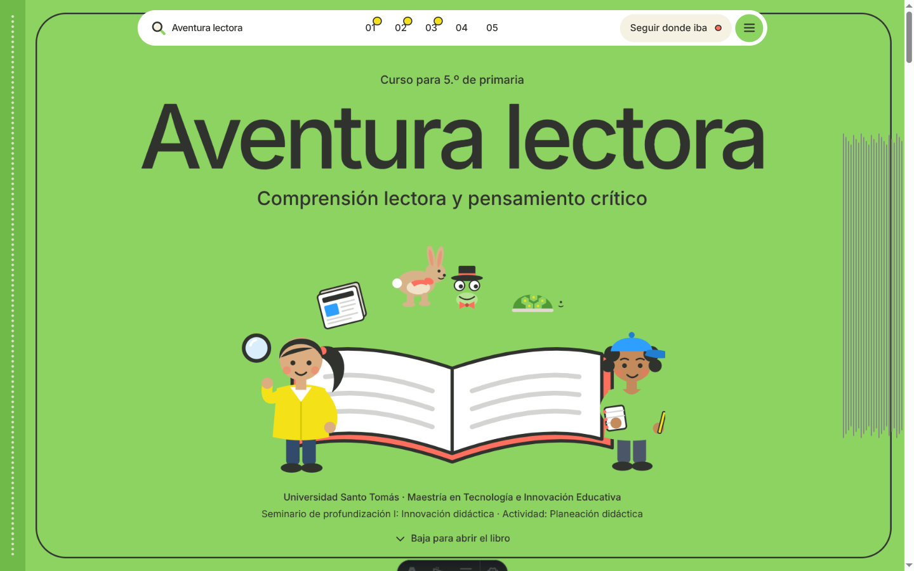

# Plantilla de Libro Interactivo y Entorno Virtual de Aprendizaje (OVA)

Plantilla web modular de codigo abierto diseñada para docentes, formadores e instituciones educativas que desean crear cursos virtuales inmersivos en formato de libro digital interactivo. Permite estructurar contenidos con navegacion fluida por desplazamiento (scroll), actividades formativas integradas y evaluacion gamificada, sin necesidad de programar desde cero.



## Proposito pedagogico

Esta plantilla facilita la publicacion de Objetos Virtuales de Aprendizaje (OVA) y Recursos Educativos Digitales (RED) siguiendo principios de diseño instruccional modernos (modelo ADDIE) y secuencias didacticas estructuradas en cuatro momentos formativos:

1. **Apertura y Exploracion:** Activacion de conocimientos previos mediante preguntas motivadoras, hipotesis y material audiovisual de introduccion.
2. **Estructuracion:** Lectura guiada con paradas de comprension, infografias interactivas y recursos multimedia de apoyo (videos y podcasts).
3. **Practica:** Modulos interactivos con retroalimentacion inmediata donde el error es formativo y permite reintentos.
4. **Valoracion y Cierre:** Retos sumativos con rubricas de evaluacion, portafolio descargable en PDF y reconocimientos gamificados (insignias y certificados).

## Caracteristicas principales

* **Experiencia de lectura inmersiva:** Formato libro con apertura de tapa, navegacion horizontal y vertical guiada por scroll y transiciones accesibles.
* **Componentes interactivos listos para usar:**
  * Tarjetas didacticas volteables (Flashcards).
  * Ruleta interactiva de preguntas y conversacion.
  * Modulos de clasificacion y ordenamiento mediante arrastrar y soltar (drag and drop).
  * Sopa de letras y cuestionarios de seleccion con retroalimentacion inmediata.
  * Tablero o muro de argumentos y evidencias (estilo muro colaborativo).
  * Grabadora de voz integrada en el navegador para practica de lectura y oralidad.
  * Visor de infografias con puntos focales interactivos.
* **Privacidad y proteccion de datos:**
  * No requiere cuentas ni contraseñas.
  * Cero cookies de terceros y sin recoleccion de datos personales (cumplimiento con normativas de proteccion de datos infantiles como la Ley 1581 de Colombia).
  * El progreso del estudiante se almacena exclusivamente en su propio navegador (localStorage e IndexedDB).
* **Diseño Universal para el Aprendizaje (DUA) y accesibilidad:**
  * Transcripciones completas para audios y subtitulos para videos.
  * Tipografias escolares de alta legibilidad (Andika para lecturas e Inter para interfaz).
  * Controles de reduccion de movimiento y modo de lectura en texto plano.
* **Generacion de documentos PDF en el navegador:** Descarga inmediata de insignias, pasaportes de logros y evidencias sin conexion a servidor.

## Estructura de contenidos y personalizacion

Para crear un nuevo curso o unidad, los docentes solo deben editar archivos de texto y configuracion:

* **Informacion del curso y equipo:** `src/config/sitio.ts` (titulo, autores, grado, institucion).
* **Navegacion y rutas:** `src/config/paginas.ts`.
* **Unidades y lecciones:** Archivos Markdown en `src/content/unidades/` y `src/content/paginas/`.
* **Banco de actividades e interactivos:** Archivos estructurados en `src/data/actividades/`.
* **Recursos multimedia:** Archivos de audio, video e infografias en `public/media/` y `src/assets/infografias/`.

## Requisitos y ejecucion local

Requisitos: Node.js (version 22 o superior) y pnpm.

```bash
# Instalar dependencias
pnpm install

# Iniciar servidor local de desarrollo
pnpm dev

# Generar version estatica lista para publicar
pnpm build

# Probar la version de produccion localmente
pnpm preview
```

## Publicacion gratuita

El sitio resultante es 100% estatico y puede publicarse en minutos en cualquier servicio gratuito de alojamiento web:

* **Vercel:** Importar el repositorio desde GitHub; la configuracion se detecta automaticamente.
* **GitHub Pages:** Despliegue automatico mediante GitHub Actions configurando la rama base.
* **Netlify:** Conectar repositorio y definir el directorio de salida como `dist`.

## Licencia

Distribuido bajo licencia MIT. Libre para adaptacion, uso academico e institucional.
